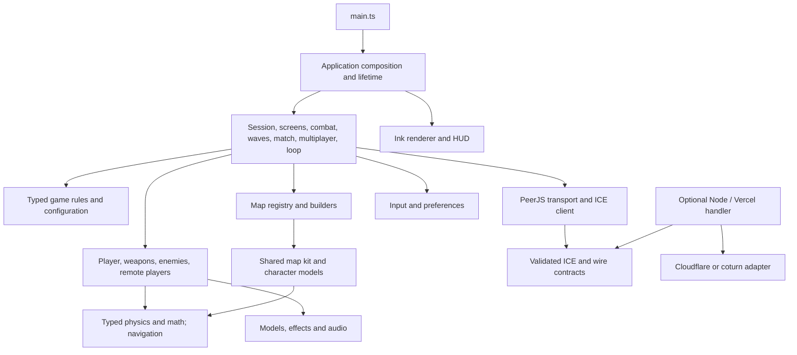

# Architecture

Paper Shooter is a modular browser game with an optional HTTP credential service. Its entry point
composes concrete adapters and controllers; a dependency container or framework is not required.

## Responsibilities

| Directory          | Owns                                                                             | Does not import                       |
| ------------------ | -------------------------------------------------------------------------------- | ------------------------------------- |
| `src/domain`       | Map metadata, wave plans, scores, match/idle rules, enemy and weapon data        | Application, DOM, HTTP, rendering     |
| `src/shared`       | ICE validation, palette identifiers                                              | Application and platform services     |
| `src/engine`       | Collision world, bodies, numeric helpers, springs, navigation, resource disposal | UI, networking, gameplay controllers  |
| `src/maps`         | Existing map content and a reusable construction kit                             | Application state and enemy AI        |
| `src/gameplay`     | Stateful player, weapons, enemy behavior, projectiles and remote models          | Screens and application orchestration |
| `src/presentation` | Ink renderer, reusable models, HUD, effects and audio synthesis                  | Application and network transports    |
| `src/platform`     | Browser input and persistent preferences                                         | Application and network transports    |
| `src/network`      | PeerJS lifecycle, lobby transport, ICE caching and wire envelopes                | Gameplay, DOM screens and rendering   |
| `src/application`  | Composition, shared session state, controller actions and scheduling             | —                                     |
| `server`           | HTTP handling, runtime configuration, rate limiting and provider adapters        | Browser application and rendering     |

`pnpm architecture` checks allowed imports, missing relative modules and import cycles across
browser, server and API modules, including literal dynamic imports and re-exports. It is part of
hooks and CI. It does not detect semantic cycles through runtime callbacks or shared mutable state.
Composition supplies commands between independent owners and adapters. SessionController owns
run/match/menu transitions; browser controls and screens request those commands. LobbyConnection
and HostMigration coordinate async connection/recovery through scoped transport/session ports.
Combat policies also have checked scoped services and an explicit composition API; they do not
register commands on a mutable game context. Participant/level readers belong to runtime. See
[ADR 0015](adr/0015-combat-capabilities-and-composition.md). Some legacy controllers still receive
runtime/action bags; an import check does not validate those semantic boundaries. `ApplicationOptions` defines replaceable rendering, input,
storage, audio and network adapters for embedding and integration tests.

## State and lifetime

`createRuntime` owns one world, level, navigation grid, renderer, audio instance, input adapter,
local player, enemy manager, connection transport, remote players and session state. Switching maps
publishes its current level/navigation through live readers. Map geometry is not edited by the
application controllers. `createApplication` wires actions before starting its animation/background
schedulers. Its idempotent `dispose()` stops schedulers, releases listeners/connections/audio and
disposes scene/rendering resources. Permanent page navigation and Vite teardown call it.

`SceneResources` belongs to the application. Register constructed nodes with `track`; `release`
retires their current subtree. Reparenting an existing tracked fragment transfers ownership without
counting it twice. Shared geometry/materials survive until their last tracked mesh or explicit cache
lease releases them. Renderer render targets and audio contexts retain their separate adapter
lifetimes. See [ADR 0008](adr/0008-scene-resource-ownership.md).

EnemyManager composes a population registry, queries, actor components, host simulation, client
playback, replication and ordered damage/death policy through checked capabilities. Actors own
navigation, perception and archetype behavior; presentation owners consume model/pose/feedback
ports. Player abilities, weapon mechanics and their views also have independent checked owners,
including their actor/weapon composition; the application runtime still binds those capabilities
from JavaScript. Remote targets use independent interpolation, animation, rope and death owners
behind checked scene/resource/pose services; see [ADR 0014](adr/0014-remote-replica-and-presentation.md). See
[ADR 0010](adr/0010-player-state-ownership.md), [ADR 0011](adr/0011-weapon-mechanics-and-presentation.md)
and [ADR 0012](adr/0012-enemy-boundaries.md).

SessionController owns its delayed input prompt. SessionTasks cancels stale connection results,
progress, errors and retry backoffs on replacement/leave/disposal. Host recovery retains score,
roster and clock authority through explicit commands. Screens no longer reset gameplay or own
menu/lobby-return transitions. See [ADR 0013](adr/0013-session-transition-ownership.md).

MatchController owns checked spawn selection, death/score reports and win checks through scoped
capabilities. It requests player-death, respawn and finish phases from SessionController; pure score
presentation functions consume a view without DOM or transport access. Session-owned DeathProgress
advances death/respawn timers and input readiness; the loop supplies its captured frame phase and
real delta. See [ADR 0016](adr/0016-match-rules-and-presentation.md).

PickupController owns checked collection, expiry and host replenishment policy through explicit
inventory/transport/state capabilities and live map readers. PickupModels retains its palette and
builds reusable map-specific geometry; collection feedback is presentation-only. See
[ADR 0017](adr/0017-pickup-policy-and-presentation.md).

WaveController owns checked solo queue/intermission/supply/checkpoint and spawn progression.
EnemyRewards independently coordinates combo/streak/focus/loot commands with a pure base-reward
calculation. Composition binds death/boss observers and grenade transport; progression receives
neither weapons nor transport. See [ADR 0018](adr/0018-wave-progression-and-rewards.md).

FocusController owns checked selection/arming/chain/execution policy. FocusDash owns collision and
steering through motion/feedback ports, while FocusMarker owns projection/live viewport conversion
without mutating target positions or allocating viewport objects per frame. Focus requests the
actor's katana command rather than reaching into weapon/frame internals. See
[ADR 0019](adr/0019-focus-policy-motion-and-marker.md), including the reviewed composition-size
exception; runtime/entry typing remains open.

UserSettings owns checked look/music/name edits and persistence/adapter synchronization.
SettingsPanel only formats/binds a narrow view and commands; checkbox and keyboard paths share
the music preference owner. PreferencePort makes save loading/writing replaceable without the
concrete storage class. See [ADR 0020](adr/0020-user-settings-and-preference-port.md).

The loop keeps the original variable timestep, capped at 50 ms, hitstop and focus scaling. Input,
simulation, death/respawn, idle/lobby updates and presentation have separate phases. Moving to a
fixed timestep, rollback netcode or a different physics engine would change behavior and needs a
separate decision and regression baseline.

## Paradigms and patterns

- Pure typed functions describe wave plans, scores, clocks, map lookup and input validation. Random
  draws and clocks can be supplied by tests.
- Stateful classes represent resources with identity: collision worlds, player bodies, connections,
  renderers and audio contexts. Reusable vectors and pools remain in frame-sensitive code.
- Small controller factories coordinate effects and state through explicit actions. Provider and
  browser adapters isolate external APIs. There is no global audio singleton.
- Ink materials are reusable without importing renderer lifecycle. Each renderer owns its palette
  and frame uniforms; material draw hooks bind that renderer's frame without sharing mutable
  lighting/time between application instances. Frame calculations run once per render, with no
  per-material lighting transform or per-frame object allocation introduced by the binding.
- Composition replaces an inheritance hierarchy for application services. The existing weapon/view
  model hierarchy remains where it already models shared behavior; an ECS is not introduced.

TypeScript strict mode covers domain rules, shared contracts, physics/math, registry, network
configuration/discovery, backend, model recipes, player/weapon components, enemy composition,
session transitions, user settings, focus/wave/reward/match/pickup rules and presentation, remote target/combat composition and lobby connection/recovery. Legacy procedural
maps/effects, transport, runtime composition and several application/presentation adapters remain
JavaScript under `allowJs` with `checkJs: false`; those boundaries are **not** fully statically checked. Tests and
coverage include them. This is an explicit incremental typing decision, not a completed conversion
of every source file. See [ADR 0003](adr/0003-modular-architecture.md).

## Remaining decomposition

Runtime composition, remaining screen read models/routing and multiplayer
message/idle/synchronization policy still need narrower
checked boundaries. The enemy subsystem now has checked composition and separate behavior,
simulation, replication and presentation owners. Extracted effects remain JavaScript, and some
map/engine/input content still needs complexity review. File length is a review signal; splitting
at an arbitrary limit does not establish ownership. A passed coverage/quality gate does not close
the [manual review](reviews/2026-11-14-refactor.md) or the remaining work under the
[engineering standard](engineering-standard.md). The independent final review remains deferred
until the user's explicit confirmation.

## Adding a map

1. Add its key/name/blurb to `src/domain/maps.ts`. Lookup and menu metadata follow the registry.
2. Implement a builder in `src/maps` using `MapKit`, then register it in `src/maps/index.ts`.
   The typed registry requires a builder for every map key.
3. Return the level contract: bounds, player start, enemy/sniper/pickup positions, arena spawns,
   breakables, animated objects and owned meshes. Call the kit's `finish()` to merge geometry and
   finalize colliders. Supply at least one valid start/spawn/pickup point.
4. Test solo and arena variants, collision clearance and multiplayer agreement. Add a recorded
   seeded output fixture only after reviewing the intended map change.

The kit exposes boxes, walls with gaps, stairs, rails, cylinders, spheres, grapple rings, spawn
markers and moving paper planes. Reusable character/weapon geometry lives in
`src/presentation/models/characters.ts`, independently of enemy AI. District and Mexico retain their
existing geometry, colliders and spawn positions. Dynamic map generation is a future consumer of
this contract; it is not implemented by this refactor.
